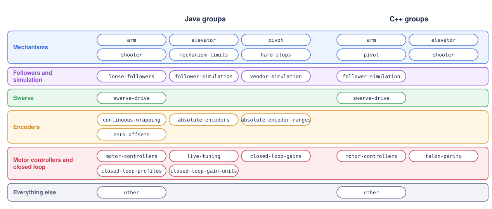
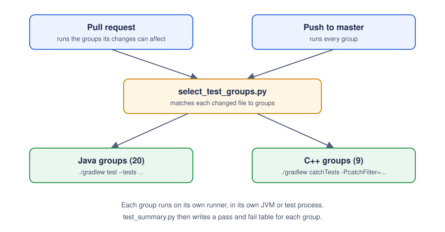

# Unit tests

YAMS checks itself with unit tests in Java (JUnit 5) and C++ (Catch2). They run in simulation, so they need no robot. The tests live in the YAMS repository under `vendordep/src/test`:

| Language | Folder | Framework |
| -------- | ------ | --------- |
| Java | `vendordep/src/test/java` | JUnit 5 |
| C++ | `vendordep/src/test/native/cpp` | Catch2 |

The tests are split into **groups**. Each group is a set of test classes (Java) or Catch2 tags (C++) that CI runs together. Every group and every test class has its own page in this section.



* [Java groups](java/README.md)
* [C++ groups](cpp/README.md)

## How CI runs them



1. A pull request runs only the groups its changes can affect. A push to `master` runs every group.
2. `.github/scripts/select_test_groups.py` matches each changed file to groups. A test file runs its own group. A mechanism or swerve source file runs the mechanism or swerve groups. Any other YAMS source or build file runs every group of its language. Docs and examples run no unit tests.
3. Each group runs on its own runner. Simulated Talons run in real time, so a group with many of them is kept on its own.
4. `.github/scripts/test_summary.py` writes a table of what passed and failed for each group.

## Run them yourself

Run commands from the `vendordep` folder of the YAMS repository. Run one group at a time, as CI does: the whole suite in one run creates more simulated devices than one process handles well, and tests start failing.

Java, one group (copy the `--tests` filters from the group's page):

```bash
./gradlew test --tests "yams.mechs.ArmTest"
```

C++, one group (copy the Catch2 filter from the group's page):

```bash
./gradlew catchTests "-PcatchFilter=[ArmTest]"
```

Test results are written to `build/test-results/test` (Java) and `build/test-results/catch2` (C++).

## Adding a test

* **Java:** add the class to a group's `--tests` filter in `select_test_groups.py`. Gradle's `--tests` cannot exclude classes, so a class that no group lists never runs in CI.
* **C++:** tag each `TEST_CASE`. A tag no group names runs in the `other` group. To give a tag its own group, add the group and add the tag to the exclusions of `other`.
